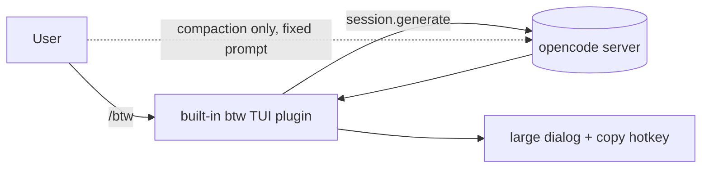
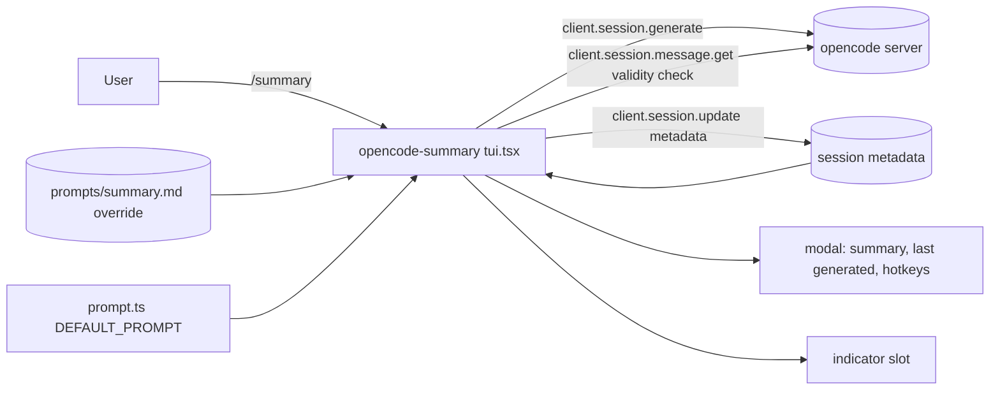

### Summary of change request

Build an opencode (V2) plugin, `opencode-summary`, in `src/opencode-plugins/opencode-summary`. The user asks for a summary of the current conversation on demand, views it, sees when it was generated, and controls the prompt. A `/summary` command opens a `/btw`-style modal with hotkeys for generate, view prompt and edit prompt. The plugin ships a default prompt. Summaries always use the conversation's current model via `session.generate`; there is no preferred-model setting and no plugin options (this supersedes task requirement 6 and the options hotkey in requirement 7).

### Current State

#### Conversation summaries
- opencode only summarizes through compaction, which replaces active context. It cannot be requested as a standalone, read-only summary.
- The compaction prompt is fixed; the user cannot change it.
- Compaction summaries show no "generated at" indicator.
- No way to keep a summary beside a conversation without altering history.

#### Side-question UI
- `/btw` answers a question in a centered dialog with a `c` copy hotkey and scroll keys. It is a built-in; it has no summary behavior and no prompt or model controls.

#### This repo
- No `src/opencode-plugins/` directory. Nothing links `src/` content into `~/.config/opencode/plugins`.
- No TypeScript, test runner or build step. Existing opencode plugins on the machine are plain ESM JS.

### Desired End State

- User types `/summary` in a session and a modal opens showing the stored summary (or an empty state) and when it was last generated.
- Hotkeys in the modal: generate/regenerate, view prompt, edit prompt (and reset to default).
- Generating uses the configured prompt (default if none) and the conversation's current model.
- The summary and its timestamp persist across TUI restarts and belong to one conversation.
- A footer indicator shows how many user turns ago the summary was generated (`summary up to date`, `summary N turns ago`).
- If any message the summary was generated from is later removed (committed revert), the summary is deleted. Newer messages or a staged, undoable revert do not remove it.
- The conversation history and active context are unchanged by summarizing.
- Plugin source lives in `src/opencode-plugins/opencode-summary` and can be linked into opencode via `links.json`.

### What we're not doing

- Not replacing or hooking into built-in compaction.
- No automatic or scheduled summaries; generation is only on user action.
- No preferred-model option or model fallback logic; the conversation's model is always used.
- No use of experimental APIs (`experimental.generate.*`); only `session.generate`.
- No V1 plugin API support.
- No summarizing a range of messages ("from here" / "up to here").
- No cross-session or project-level summary index.
- No publishing to npm.

### Proposed End State Architecture

Before:



After:



```text
src/opencode-plugins/opencode-summary/
  tui.tsx             # Plugin.define({id, setup}): keymap layer, /summary, modal, indicator, generate, metadata
  prompt.ts           # DEFAULT_PROMPT
  lib.ts              # pure helpers (no opencode imports)
  lib.test.ts         # bun test
  prompts/summary.md  # user override; created by the edit hotkey, deleted by reset; tracked in git
  README.md
```

No `package.json`, no server entry, no build: opencode loads the root `tui.tsx` by file name.

```text
generate(sessionID)
  if status(sessionID) == "running": toast "Agent is running"; return
  if inFlight.has(sessionID): toast "Already generating"; return
  prompt = GUARD + "\n\n" + (read(prompts/summary.md) ?? DEFAULT_PROMPT)   # read at generate time
  lastMessageID = newest message id below session.revert.messageID (or newest overall)  # captured before the call
  text   = session.generate({sessionID, prompt})   # session's current model
  if error or text blank: error toast; keep old record; return
  save({text, generatedAt: now, promptId: hash(prompt), lastMessageID}) for sessionID   # read-merge-write
  if modal closed: toast "Summary ready"

load(sessionID)                                     # modal open, indicator render
  record = metadata["opencode-summary"]
  if !record: return none
  if session.message.get(sessionID, record.lastMessageID) -> MessageNotFound:
    delete metadata["opencode-summary"]; return none
  return record
```

Modal hotkeys: `g` generate, `v` toggle prompt view, `c` copy (summary view only), `e` edit and `r` reset prompt (prompt view only), `j/k`/arrows scroll, `esc` close (see "Hotkeys").

### Design Questions

_None open._

### Resolved Design Questions

#### Plugin shape

TUI-only plugin - one `tui` entry point, no server entry, no server stub, no RPC. Verified against the V2 source (`e5f2dde`, `packages/plugin/src/tui/context.ts`): the TUI context exposes everything needed.

| Need | TUI API |
|---|---|
| Generate | `client.session.generate({sessionID, prompt})` (as `/btw`, `btw.tsx:68`) |
| Store / delete summary | `client.session.update({sessionID, metadata})` |
| Validity check | `client.session.message.get({sessionID, messageID})` |
| Session info, events | `data.session.get`, `data.session.message.list`, `data.on` |
| Prompt override | file in plugin dir via `node:fs` (see "Prompt source") |
| UI | `keymap.layer`, `ui.dialog`, `ui.slot`, `ui.toast` |

Consequences: `/summary` exists only in the terminal TUI (not web/desktop); the TUI-only plugin runs locally, so it works against a remote server. `session.generate` exposes the session's tools but runs no tool loop, so the default prompt must forbid tool calls (`btw.tsx:15-16`).

Not chosen:
- Server + TUI with RPC (`opencode-handoff` style): more code, only needed for non-TUI clients.
- TUI + server `/summary` command: web/desktop trigger without a modal; out of scope.

#### Language and build

TSX, no build - `tui.tsx` and `prompt.ts` at the plugin root, loaded as-is. A local plugin directory without `package.json` `exports` uses root file names `tui` with `.ts`, `.tsx` or `.js` (`services/www/src/docs/content/build/plugins/index.mdx:87-89`); the docs' examples use `tui.tsx` and Solid JSX (`build/plugins/cli.mdx:10-22,259-263`). `@opencode/plugin/tui` is resolved by opencode at runtime, so no install (`cli.mdx:21-22`). The "skips Solid's TSX transform" issue noted by dir-tree/skills-tui applies only inside `node_modules`.

Consequence: types are stripped, not checked (no `tsconfig`, no `tsc` in the repo).

Not chosen:
- TSX + `tsconfig` typecheck: adds `package.json`, devDeps and `node_modules` to the repo.
- Plain JS without JSX: verbose `createElement`-style modal, differs from docs and `/btw`.
- TSX + `Bun.build` to `dist/`: only needed for npm publishing (out of scope).

#### Installation into opencode

Symlink via `links.json`: `~/.config/opencode/plugins/opencode-summary` -> `src/opencode-plugins/opencode-summary`. Add the entry to the tracked `links.example.json` (new group, e.g. `opencode-plugins`); the user copies it into their gitignored `links.json` and runs `python tools/syncLinks/sync.py`, then `--check`. The TUI discovers directories and symlinked directories in `<global-config>/plugins/` (`tui/src/plugin/discovery.ts:8-50`), so no config edit is needed.

```json
"opencode-plugins": {
  "links": [
    { "link": "${home}/.config/opencode/plugins/opencode-summary",
      "target": "${src}/opencode-plugins/opencode-summary", "type": "symlink" }
  ]
}
```

Consequence: a discovered plugin gets `options` = `{}`. Options require an extra `cli.json` `plugins` entry for the same path, which overrides the discovered one (`tui/src/plugin/context.tsx:288-307`); see "Option source". `opencode.jsonc` entries do not reach a TUI-only plugin.

Not chosen:
- `cli.json` entry only: machine-specific absolute repo path, not declared in the repo.
- Symlink + mandatory `cli.json` entry: extra manual step when defaults suffice.

#### Prompt source and "edit prompt" persistence

Prompt stored at the plugin level, no config options. `DEFAULT_PROMPT` lives in `prompt.ts`; the user's prompt lives in `prompts/summary.md` inside the plugin directory. Through the symlink this is the repo copy, so edits are versioned in git. Both files are tracked.

- Effective prompt = `prompts/summary.md` if present, else `DEFAULT_PROMPT`. Read at generate time, so edits apply immediately with no restart.
- Edit hotkey writes `prompts/summary.md` (created on first edit). Reset deletes it.
- View hotkey shows the effective prompt and which source is active (default / override file).
- Plugin directory resolved from `import.meta.url` of `tui.tsx`; file I/O via `node:fs/promises` (TUI plugins run locally in Bun).
- Subfolder `prompts/` keeps writes away from the plugin root, which the hot-reload watcher watches for any filename (`tui/src/plugin/watch.ts`, `context.tsx:252-268,343`). A spurious reconcile from the root would likely be a no-op (unchanged generation is skipped), inferred, not run.
- Prompt is global across projects.
- `promptId` in the summary record = short hash of the effective prompt text, so the modal can show "generated with a different prompt".

```ts
const dir = path.dirname(fileURLToPath(import.meta.url))
const overridePath = path.join(dir, "prompts", "summary.md")
const loadPrompt = () => readFile(overridePath, "utf8").catch(e => e.code === "ENOENT" ? DEFAULT_PROMPT : Promise.reject(e))
```

Consequence: `ctx.options` is unused and the plugin has no options (see "Plugin options hotkey").

Not chosen:
- Modal edit to `storage.store`: not versioned; lives in opencode's state directory (`<state>/<channel>/tui/plugin.<id>.<key>.json`, `tui/src/plugin/api.tsx:201`, `context/storage.tsx:52-58`).
- `cli.json` options (+ modal override): extra manual entry for a symlinked plugin, inline string only (`cli.json` has no `{file:}`/`{env:}`, `cli/src/config/config.ts:31-39,144-146`), restart needed, ambiguous precedence. `opencode.jsonc` options do not reach a TUI-only plugin.
- Single `prompts/summary.md` overwritten by edits: reset would need `git checkout`.

#### LLM call mechanism

`session.generate({sessionID, prompt})` only - the `experimental.generate.*` APIs are experimental and may change, so the plugin does not depend on them. It sends the session context plus the prompt as the last user message, leaves history unchanged and runs on the conversation's current model.

```js
const { data } = await client.session.generate({ sessionID, prompt })   // data.text
```

Not chosen:
- `experimental.generate.text({prompt, model})`: only path with a per-call model, but experimental and needs the plugin to pass the conversation itself (context-size risk).
- Child session with `model` set at create: extra rows, hidden-session handling and cleanup.

Consequence: no preferred-model option and no availability/fallback logic. This drops task requirement 6; the design supersedes the task.

#### Where the summary is stored

Session `metadata` (`PATCH /api/session/:id`, `client.session.update({sessionID, metadata})`) under a single plugin-owned key, e.g. `metadata["opencode-summary"] = {text, generatedAt, promptId, lastMessageID}`. Durable, per session, deleted with the session (no cleanup code), and readable from `Session.Info.metadata`. The update replaces the whole metadata object, so every write must read the current metadata, merge its key and write the full object back.

```js
const current = data.session.get(sessionID)?.metadata ?? {}
await client.session.update({
  sessionID,
  metadata: { ...current, "opencode-summary": { text, generatedAt: Date.now(), promptId, lastMessageID } },
})
```

Not chosen:
- Plugin `storage` keyed by `sessionID`: isolated, but not removed on session delete (needs `session.deleted` cleanup) and not inherited by forks.
- Sidecar files (Kiro Crew style): needs path, locking and cleanup logic.

Consequences: other plugins can read the summary; the full summary text lives in the session row; a concurrent metadata write by another plugin between read and write can be lost (read-merge-write is not atomic); forks inherit the metadata, but the validity check below deletes it there.

#### Summary validity after revert (and fork)

Keep the summary only while every message that existed at generation is still present; otherwise delete it. Checked at read time (modal open, indicator render), not on events, so reverts made while this TUI was closed or from another client are still caught.

The record stores `lastMessageID`, the last message when the summary was generated. Messages are only deleted by a committed revert, which removes every message from the boundary onward (`projector.ts:798-826`; the only other delete is V1 migration). So "all original messages present" is the same as "`lastMessageID` still exists". Message IDs are ascending (`schema/src/session-message.ts:21-25`).

```js
async function load(sessionID) {
  const record = data.session.get(sessionID)?.metadata?.["opencode-summary"]
  if (!record) return undefined
  const exists = await client.session.message
    .get({ sessionID, messageID: record.lastMessageID })
    .then(() => true, (e) => (isMessageNotFound(e) ? false : Promise.reject(e)))
  if (exists) return record
  await removeSummary(sessionID)          // read-merge-write without the key
  return undefined
}
```

- Newer messages after the summary: kept (originals all present).
- Committed revert at or before `lastMessageID`: deleted.
- Fork: forked messages get new IDs (`<eventID>_<seq>`, `projector.ts:188`), so the inherited `lastMessageID` is not found and the fork's copy is deleted. Parent unaffected. Replaces the earlier fork question.
- Child sessions: inherited metadata points at a parent message, so it is deleted the same way.
- Errors other than `MessageNotFoundError` (network, server down): keep the record, do not delete.

Not chosen:
- Delete on `session.revert.committed` events: misses reverts while the TUI is closed and deletes even when the revert only removed messages after the summary.
- Keep and mark "outdated": user chose deletion.

#### Staged (uncommitted) revert

Retain the summary - the revert is not committed yet. A staged revert sets `session.revert = {messageID, …}` and hides later messages, but they stay in the DB and `session.revert.cleared` restores them (`core/src/session/revert.ts`, `projector.ts:792-797`). The read-time check finds `lastMessageID`, so no special case is needed. If the revert is later committed (next prompt or `compact`, `core/src/session/session.ts:173,264`) and removes `lastMessageID`, the next load deletes the summary.

Not chosen:
- Delete on stage: loses the summary if the user undoes the revert.

#### Generating during a staged revert

Allow, with `lastMessageID` capped at the revert boundary: the newest message whose id is below `session.revert.messageID` (a staged revert hides messages from the boundary on). The turn count and the validity rule then match what the user sees. Known limit: `session.generate` never reads `revert` (`session/context.ts`, `session/generate.ts`, inferred from source, not run), so the text may still mention hidden messages; accepted. If the revert is later committed and removes `lastMessageID`, the next load deletes the summary.

Not chosen:
- Block: safe, but the user cannot regenerate while deciding about a revert (superseded by user decision).
- Allow with uncapped `lastMessageID`: count and validity would reference hidden messages.

#### Generating while the agent is running

Block. While `data.session.status(sessionID) === "running"` (`plugin/src/tui/context.ts:75`), `g` shows a warning toast "Agent is running - wait for it to finish"; the footer marks generate unavailable. `session.generate` has no busy check and reads whatever history is projected (`core/src/session/generate.ts:26-73`), so it could summarize a partial turn.

Related facts from the same source: `session.generate` only logs usage (no `session.usage.recorded`), so its cost is not added to the session (research open question 2); history comes from `SessionHistory.preview`, i.e. after the latest compaction, so a post-compaction summary is built from the compaction summary plus the kept tail.

Not chosen:
- Queue until idle: extra state (cancel on close, session switch).
- Allow: partial-turn summaries.

#### Default prompt content

TL;DR section first, then short structured sections with bullets. Markdown, no preamble, roughly 300 words or less, written for a human reader.

Tool guard: the plugin always prepends a fixed `GUARD` line ("Do not call any tools and do not take any actions.") to the effective prompt (default or override). It is not part of `DEFAULT_PROMPT` or `prompts/summary.md`; view-prompt shows it as a fixed, non-editable first line. Reason: `session.generate` exposes tools but runs no tool loop, so a tool call yields an empty answer (`btw.tsx:15-16`).

```ts
const request = [GUARD, await loadPrompt()].join("\n\n")
```

```md
Summarize the conversation so far for the user.
Output markdown only, no preamble, about 300 words or less. Use exactly these sections, bullets only below TL;DR; omit a section if empty:

## TL;DR
2-3 sentences.
## Goal
## Decisions
## Progress / current state
## Open questions / next steps
## Key files and references
```

Not chosen:
- TL;DR + flat bullets: loses structure.
- opencode compaction `SUMMARY_TEMPLATE` verbatim (`core/src/session/compaction.ts:166-197`): long, tuned for a model reader.

#### Generate failure

A 3 min timeout (`GENERATE_TIMEOUT_MS`) races the call, because `session.generate` has no abort signal and a hung call would otherwise keep the session in the in-flight set forever (seen in manual testing). On timeout: "Summary timed out" error toast, in-flight cleared. The late response, if any, is ignored.

Keep the old summary; error toast (`ui.toast.show({variant: "error"})`). A failed call or empty/whitespace text never writes metadata, so the modal keeps the old summary and timestamp and `g` can be retried.

Not chosen:
- Clear on failure: loses a valid summary.
- Inline error in the modal: toast is enough.

#### Closing the modal or switching session during generation

Finish in background. The call keeps running and writes to the original `sessionID`'s metadata; the footer spinner stays for that session. If the modal is closed when it finishes, toast "Summary ready" (with `sessionID` so it targets that session). One generation per session per TUI: in-flight set kept in `storage.memory` (survives plugin hot reload, `plugin/src/tui/context.ts:42-52`); `g` during one shows "Already generating". Two TUIs generating at once: last write wins.

Not chosen:
- Cancel on close: tokens still billed; no abort signal seen on `session.generate`.
- Lock the modal: blocks the user.

#### Hotkeys

Modal keymap layer (`mode: "modal"`, as `/btw`, `btw.tsx:113`), hints in the footer:

| Key | Action |
|---|---|
| `g` | Generate / regenerate (blocked when running) |
| `v` | Toggle summary / prompt view in the same modal (prompt view shows the fixed guard line, then the effective prompt and its source) |
| `e` | Edit prompt (`$EDITOR`, textarea fallback); prompt view only |
| `r` | Reset prompt to default, after `ui.dialog.confirm`; prompt view only |
| `c` | Copy summary markdown (summary view only) via `context.renderer.copyToClipboardOSC52(text)`; toast on failure (the TUI clipboard service is internal) |
| `j/k`, up/down, pageup/pagedown, home/end | Scroll (as `/btw`, `useKeyboard`) |
| `esc` | Close (or leave prompt view) |

No default global keybind (same as `/btw`'s `session.aside`); reachable via `/summary` and the palette. Users can bind `summary.open` in `cli.json` `keybinds`.

Not chosen:
- Default `<leader>` bind: clash risk with built-ins.

#### Derived minor decisions

Follow from the decisions above or from `/btw`; listed for review.

- `/summary` outside a session route: warning toast "Open a session first" (as `btw.tsx` `run`).
- No summary yet: modal shows "No summary yet - press g to generate".
- Subagent/child sessions: allowed; their inherited metadata is dropped by the validity check.
- Plugin id `opencode-summary`; metadata key `opencode-summary`; command id `summary.open`, slash `summary`, palette group "Summary".
- Repo `README.md` layout lists `src/opencode-plugins/`.
- Edit: empty save = no change + warning; saving text identical to `DEFAULT_PROMPT` deletes the override.

#### Plugin options hotkey

Dropped. The plugin has no options left (no model, prompt is file-based), and view-prompt already shows the prompt source. Supersedes the "see the summary plugin options" part of task requirement 7.

Not chosen:
- Read-only info panel (prompt source, paths, ids): duplicates view-prompt.
- Real settings in `storage.store`: new scope.

#### Indicator outside the modal

`prompt.footer.status` slot (props `{sessionID?, mode, showDetails}`, `plugin/src/tui/context.ts:159-163,196`), same spot as the `/btw` spinner (`btw.tsx:28-39`). Muted text measured in turns, not time; hidden when there is no valid summary. While generating, a `/summary` spinner like `/btw`'s.

| User messages after `lastMessageID` | Text |
|---|---|
| 0 | `summary up to date` |
| 1 | `summary 1 turn ago` |
| N (2-199) | `summary N turns ago` |
| 200+ | `summary 200+ turns ago` |

- Turn = a `user` message (excludes synthetic, shell, skill, system, compaction, assistant).
- Count with one server-filtered call; message IDs are ascending, so "after" is an ID comparison. The TUI cache holds only the newest ~20 raw messages (`client/src/solid/data.ts:92,1826`), so it is not used for counting.

```ts
const { data } = await client.message.list({ sessionID, type: "user", order: "desc", limit: 200 })
const turns = data.filter(m => m.id > record.lastMessageID).length   // 200 -> "200+"
```

- Recompute (debounced) on: slot `sessionID` change, `session.inbox.delivered` (user message projected, `core/src/session/projector.ts:675-687`), `session.metadata.updated`, `session.revert.committed` (also runs the validity check). `session.revert.staged`/`cleared` update the generate-blocked state.

Not chosen:
- Time-based `summary 5m ago`: user prefers turns; the modal still shows the generation time.
- Sidebar panel, `session.composer.top`, modal only.

#### Modal "last generated" text

Relative + absolute + turns, e.g. `Generated 2h ago · 14:05 · 11/5/2026 · 3 turns ago`. Local copies of the TUI helpers (internal, not in the plugin API): stash-style relative time (`tui/src/component/dialog-stash.tsx:9-22`) and `Locale.datetime` (`tui/src/util/locale.ts:7-17`). For 7+ days the relative part is omitted (the stash helper falls back to the datetime). Turns use the indicator wording. Recomputed on modal open and on the indicator's events; no ticking timer (matches `dialog-open.tsx` `timeAgo`).

```ts
function relative(ts: number) {                       // copy of getRelativeTime, minus datetime fallback
  const s = Math.floor((Date.now() - ts) / 1000), m = Math.floor(s / 60), h = Math.floor(m / 60), d = Math.floor(h / 24)
  if (s < 60) return "just now"; if (m < 60) return `${m}m ago`; if (h < 24) return `${h}h ago`; if (d < 7) return `${d}d ago`
}
const datetime = (ts: number) => `${new Date(ts).toLocaleTimeString(undefined, { timeStyle: "short" })} · ${new Date(ts).toLocaleDateString()}`
```

Not chosen:
- Absolute + turns, relative + turns, `Intl.RelativeTimeFormat` (no precedent in the TUI).

#### Modal layout components

Own layout from public pieces: `ui.dialog.show(render)` + `ui.dialog.set({size: "large", centered: true})` (88 cells), built from OpenTUI `<box>`, `<text>`, `<scrollbox>`, `<markdown>`. Copy `/btw`'s look from the internal components (`tui/src/ui/dialog.tsx`): horizontal inset 3, `gap={1}`, `paddingBottom={1}`; header row space-between with bold `text.base` title and muted `esc`; footer with muted `title key` hints. Theme via the plugin `theme` tokens (`text.base`, `text.muted`).

Not chosen:
- Import `DialogLayout`/`DialogHeader`/`DialogFooter`: not in `@opencode/plugin/tui`; breaks on internal refactors.
- `ui.dialog.select`-based: poor fit for a long markdown summary.

#### Testing approach

`bun test` for pure logic plus a manual UI checklist. Pure functions live in `lib.ts` (no imports from `@opencode/plugin/tui`, which only resolves inside opencode): turn wording, relative/absolute time, prompt resolution (override file vs default), metadata merge/remove, validity decision, revert-blocked check. Tests in `lib.test.ts`, run with `bun test` from the plugin dir; no dependencies, no `package.json`. The TUI loader only loads root `tui.*`, so the test file is not loaded as a plugin.

Manual checklist in the README: generate, view/edit/reset prompt, restart persistence, footer wording (0/1/N turns), revert commit deletes, revert undo keeps, staged revert blocks generate, fork drops summary.

Not chosen:
- Manual only: leaves the deletion and wording rules unchecked.
- TUI render tests: needs `@opentui` deps and `node_modules` in the repo.

#### Edit prompt UX

`$VISUAL`/`$EDITOR` first, in-modal textarea fallback. Mirrors the TUI's `openEditor` (`tui/src/editor.ts:14-39`) using the plugin `renderer` (`plugin/src/tui/context.ts:548`), but edits `prompts/summary.md` in place instead of a temp file.

```ts
const editor = process.env.VISUAL || process.env.EDITOR
if (!existsSync(overridePath)) await writeFile(overridePath, await loadPrompt())   // seed with current prompt
await context.renderer.suspend()
try { await spawnAndWait(editor, overridePath) } finally { await context.renderer.resume() }
```

- No editor set: modal `<textarea>` seeded with the current prompt; `ctrl+s` saves to `prompts/summary.md`, `esc` cancels (as `opencode-handoff`'s review dialog).
- Saved content empty: no change, warning toast. Saved content identical to `DEFAULT_PROMPT`: delete the override (same as reset).
- Editor exits non-zero: error toast, file left as the editor left it.

Not chosen:
- `$EDITOR` only: no path when unset.
- Textarea only: clumsy for long prompts.

### Patterns to follow

These show the patterns found in the existing codebase and prior art that will be followed to implement the proposed end state architecture.

#### Plugin definition and entry points

TUI part as a root `tui.tsx` default-exporting `Plugin.define({id, setup})` from `@opencode/plugin/tui` (resolved at runtime) - `services/www/src/docs/content/build/plugins/cli.mdx:10-22`

```tsx
import { Plugin } from "@opencode/plugin/tui"

export default Plugin.define({
  id: "acme.cli",
  setup(context) {
    context.ui.toast.show({ message: "TUI plugin loaded", variant: "success" })
  },
})
```

```tsx
// src/opencode-plugins/opencode-summary/tui.tsx
export default Plugin.define({ id: "opencode-summary", setup(context) { /* keymap layer, slot, dialog */ } })
```

#### TUI command with slash, palette and keymap layer

One keymap-layer entry registers slash, palette and keybind; use `mode: "global"` so slash completion and the palette work - `opencode-quota`, `opencode-dir-tree-tui`

```js
context.keymap.layer(() => ({
  mode: "global",
  commands: [{ id: "summary.open", title: "Session summary", group: "Summary",
               palette: true, slash: { name: "summary" }, run: openModal }],
}))
```

#### Modal dialog with hotkey layer

`/btw` answer dialog: `ui.dialog.show` + `set({size:"large", centered:true})`, modal keymap layer with `c`, footer hint actions; capture the plugin context outside the dialog component - `packages/tui/src/feature-plugins/prompt/btw.tsx:46,88-189`

```js
ui.dialog.show(() => <Summary />)
ui.dialog.set({ size: "large", centered: true })
Keymap.createLayer({ mode: "modal", commands: [{ bind: "g", title: "Generate", group: "Dialog" }] })
```

#### Per-session data in session metadata

`Session.Metadata = Record<string, Json>`, set via `PATCH /api/session/:id`, replaces the whole object, emits `session.metadata.updated` - `schema/src/session-metadata.ts`, `protocol/src/groups/session.ts:301-312`

```js
await client.session.update({ sessionID, metadata: { ...current, "opencode-summary": record } })
```

React to updates from other TUIs or reloads:

```js
data.on("session.metadata.updated", e => { if (e.data.sessionID === sessionID) refresh() })
```

#### Side-question prompt that forbids tools

`session.generate` exposes tools but runs no tool loop; `/btw` prepends instructions forbidding tool calls - `packages/tui/src/feature-plugins/prompt/btw.tsx:15-21`

```ts
const instructions = [
  "The user is asking a quick side question about the conversation so far.",
  "Answer directly and concisely in markdown from what you already know.",
  "Do not call any tools and do not take any actions.",
```

#### Link tooling

Declare links in `links.example.json` / `links.json` (`vars` `home`, `src`; `type: "symlink"`) and audit with `python tools/syncLinks/sync.py --check`; do not run `mklink` by hand - `links.example.json:3-18`, `AGENTS.md`, `tools/syncLinks/README.md`

```json
{ "link": "${home}/.config/some-tool/skills", "target": "${src}/skills", "type": "symlink" }
```

```json
{ "link": "${home}/.config/opencode/plugins/opencode-summary", "target": "${src}/opencode-plugins/opencode-summary", "type": "symlink" }
```

### Additional Spec Docs

| Path | Description |
|---|---|
| _none_ | |
