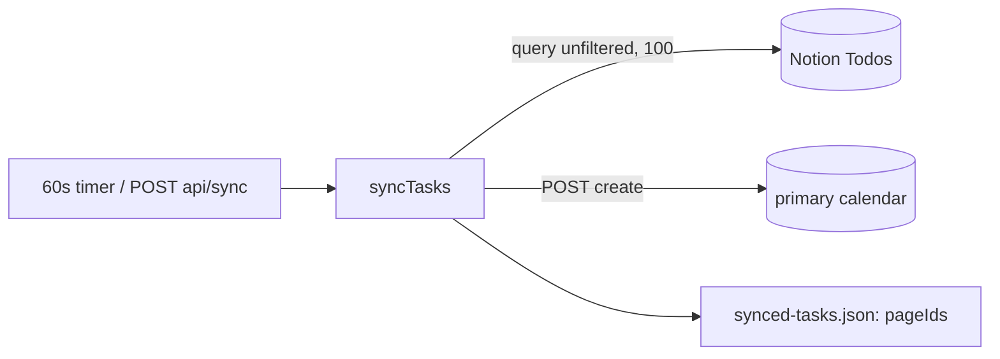
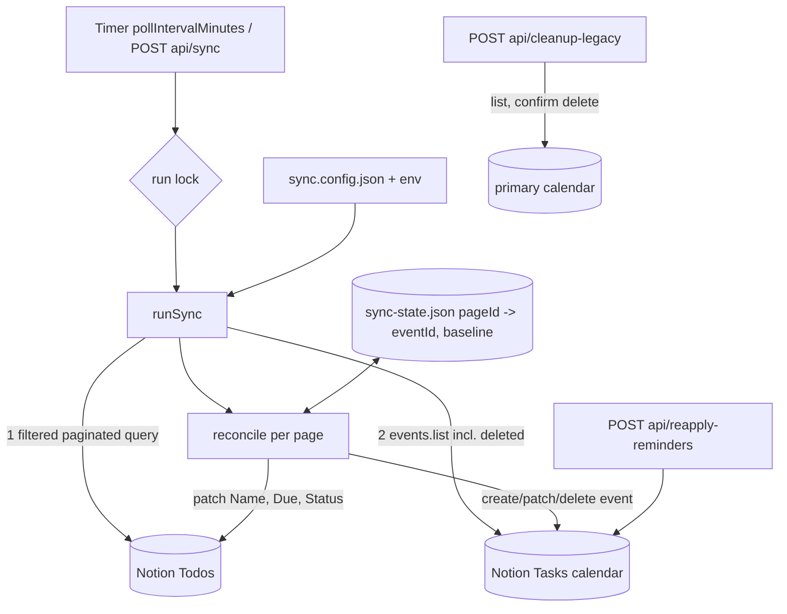

### Summary of change request

Turn the one-way, create-only Notion → Google Calendar demo into a two-way sync between the "Todos" Notion database and a dedicated "Notion Tasks" calendar. Only upcoming, active tasks appear, as all-day entries with reminders. Edits and deletes flow both ways with conflict handling, on a configurable 30 min poll.

### Current State

#### Notion → Calendar

- Every poll creates timed 1-hour events at 09:00 UTC for any unsynced page with a title and date, regardless of status or how old the date is.
- Events land on the personal primary calendar mixed with real events.
- Changing or completing a task in Notion never changes or removes its event.

#### Calendar → Notion

- Nothing flows back. Editing or deleting an event has no effect on Notion.

#### Operations

- Polling is every 60 s, fixed. Only the first 100 Notion rows are seen.
- Events have no reminders.
- Config is env vars plus hardcoded constants; nothing is validated at startup.
- Old synced events cannot be told apart from the user's own events except by a description string.

### Desired End State

- Tasks with `Due >= today` and status Pending / In progress / On-hold appear as all-day entries in a "Notion Tasks" calendar, created automatically.
- Title and date edits in either app reach the other within one poll; no echo loops.
- Completing or dropping a task, or moving it out of the window, removes its entry.
- Deleting an entry marks the task `Archived/Dropped`; it is not recreated.
- Entries get popup reminders from presets (default `standard`), overridable per tag.
- Poll interval, statuses, names, time zone, reminders live in a validated `sync.config.json`; env vars override.
- On-demand `POST /api/sync`, `POST /api/reapply-reminders`, and a dry-run-first `POST /api/cleanup-legacy`.
- Restart never duplicates entries.

### What we're not doing

- Syncing reminders, status (except `markDropped`), or tags to Notion.
- Creating Notion pages from new Calendar entries.
- Multiple databases or users; `USER_ID` stays `demo-user-1`.
- Production Pipedream environment.
- Webhooks / push notifications; polling only.
- Touching any calendar other than "Notion Tasks" (the legacy cleanup reads/deletes in `primary` only after explicit confirm).

### Proposed End State Architecture

Before:



After:



Proposed file split in `tools/pipedream/notion-to-google-calendar/` (ESM, one concern per module so pure logic is testable without network):

```text
server.js              # express routes, timer, wiring
src/config.js          # load sync.config.json + env overrides, validate
src/state.js           # load/save sync-state.json (atomic write)
src/notion.js          # query (filter+pagination), patch page, property parsing
src/gcal.js            # find/create calendar, list/create/patch/delete events
src/mapping.js         # Notion date <-> all-day start/end(exclusive), event body
src/reminders.js       # presets, byTag resolve, validation
src/reconcile.js       # pure: (notion, event, baseline) -> actions
src/sync.js            # runSync orchestration, run lock
src/legacy.js          # dry-run list / confirmed delete
test/*.test.js         # node:test unit tests for pure modules
sync.config.json       # committed, no secrets
```

Config shape (excerpt):

```json
{
  "pollIntervalMinutes": 30,
  "timeZone": "Asia/Manila",
  "notion": { "databaseId": null, "titleProperty": "Name", "dateProperty": "Due",
              "statusProperty": "Status", "tagsProperty": "Tags",
              "syncStatuses": ["Pending", "In progress", "On-hold"],
              "droppedStatus": "Archived/Dropped" },
  "calendar": { "name": "Notion Tasks" },
  "twoWay": { "calendarToNotion": true, "onEventDeleted": "markDropped" },
  "reminders": { "defaultPreset": "standard",
                 "presets": { "light": {}, "standard": {}, "heavy": {} },
                 "byTag": {} }
}
```

Per-page reconcile (pure function, three-way against baseline):

```text
inputs: n = notion {title,date,lastEdited} | null (not in window/status)
        e = event  {title,date,updated} | cancelled | missing
        b = baseline {title,date} | none

if no b:
  n eligible -> create event, store state+baseline
  else       -> nothing
if n not eligible (status/window):
  delete event if present; drop state          # not a user delete
if e cancelled/missing (user delete):
  patch Notion Status=Dropped; drop state; keep tombstone so not recreated
nChanged = n != b ; eChanged = e != b
neither       -> noop
only n        -> patch event, baseline = n
only e        -> patch Notion, baseline = e
both, equal   -> baseline = n
both, differ  -> newer(n.lastEdited, e.updated) wins; log; patch loser; baseline = winner
after any write: re-read or compute values written and store as baseline
```

### Design Questions

#### Code structure

Where does the new logic live?

- Option A: keep everything in `server.js`.
- Option B: split into `src/` modules with pure reconcile/mapping/reminder/config logic (above).

Reccomendation: B. Current file is already 267 lines and the new logic is mostly pure and needs unit tests.

#### Test approach

The tool has no tests (research §1).

- Option A: none, curl only (current convention).
- Option B: `node:test` + `node --test`, no new dependency, covering pure modules plus a fake `makeProxyRequest` for orchestration.
- Option C: add vitest/jest.

Reccomendation: B. Zero deps; date mapping and conflict logic are the risky parts.

#### Calendar → Notion change detection

- Option A: `events.list` with `updatedMin = lastRunAt`, `showDeleted=true`. Cheap, but misses changes if a run fails midway or clocks skew, and `updatedMin` also returns our own writes.
- Option B: list all mapped events each run (`privateExtraProperty=notionPageId`, `showDeleted=true`) and compare each to baseline. Larger payload but stateless w.r.t. time and self-healing.

Reccomendation: B. Baseline comparison is required anyway to avoid echoes; the calendar holds tens of entries.

#### Detecting user-deleted vs app-deleted events

- Option A: remove `pageId` from state before the app deletes an event, so a later cancelled event has no mapping. Fails if the DELETE then errors (network, 5xx): no mapping remains, so nothing retries and the event is orphaned.
- Option B: set `pendingDelete` on the existing state entry, save, DELETE, then remove the entry on success or 404/410.

Reccomendation: B. A later run retries any entry flagged `pendingDelete`; such entries are never treated as user-deleted and never recreated.

#### Not recreating a dropped task

After a user delete sets `Status=Archived/Dropped`, the task leaves the status list, so it is naturally not recreated.

- Option A: rely on the status filter alone.
- Option B: also keep a tombstone `{ pageId: droppedAt }` in state for when the Notion write fails.

Reccomendation: B. Retry the Notion write next run; never recreate while a tombstone exists.

#### All-day date range mapping

Notion `Due` may be a date, a date range, or have a time.

- Option A: use only the date part of `start`; if `end` exists use `end + 1 day` as exclusive end; ignore times.
- Option B: skip tasks with times or ranges.

Reccomendation: A. Calendar → Notion writes back date-only start, and `end` only if the entry spans more than one day. Datetime Due loses its time on round trip when edited from Calendar; document it.

#### Time zone for "start of today" and date-time → date

- Option A: config `timeZone` (IANA), default system zone, via `Intl.DateTimeFormat`.
- Option B: always UTC.

Reccomendation: A, validated at startup with `Intl`.

#### "Latest edit wins" timestamps

Compare Notion `last_edited_time` with Google `updated`. Notion's value has minute precision (V12).

- Option A: compare directly; on tie prefer Notion.
- Option B: always prefer Notion on conflict.

Reccomendation: A, as the task states, with Notion winning ties.

#### State file and migration

- Option A: new file `sync-state.json` (`version: 2`); old `synced-tasks.json` ignored (not migrated, since it holds no event IDs).
- Option B: same file, versioned.

Reccomendation: A. Avoids reading the old shape as the new one; document that old file can be deleted.

#### Run concurrency

- Option A: in-process boolean lock; overlapping calls return 409 / skip.
- Option B: queue.

Reccomendation: A.

#### Reminder minutes for all-day events

Pending verification V9. Presets are expressed as `{ daysBefore, at: "HH:MM" }` or raw `minutes`. Computed offsets must be non-negative, so shipped defaults use day-before evening times (e.g. 1 day before at 18:00 = 360); same-day-at-09:00 is unsupported and rejected by startup validation, as are presets missing `allDay` or `timed`.

- Option A: presets as raw minutes-before-00:00 (matches Google's field; no conversion).
- Option B: presets as local clock time + days before, converted to minutes.

Reccomendation: B for readability; the conversion is one pure function covered by tests, and V9 is fixed in one place if wrong.

#### Calendar → Notion title edits and the legacy description

New events carry the page ID in `extendedProperties.private.notionPageId` and a description linking the Notion page URL. Legacy events have the old description.

- Option A: ignore description entirely for matching; match only by `notionPageId`.
- Option B: also recognize legacy description.

Reccomendation: A for sync; B only inside `cleanup-legacy`, scoped to `primary`.

### Resolved Design Questions

None yet. All questions above are open for the captain.

### Patterns to follow

#### Pipedream proxy call shape

Every vendor call goes through `makeProxyRequest` with the account lookup. `server.js:57-75`. The new `notion.js` and `gcal.js` share one `request(appSlug, {url, method, body})` wrapper.

```js
await pd.makeProxyRequest(
  { searchParams: { external_user_id: USER_ID, account_id: account.id } },
  { url, options: { method: 'POST', headers: {...}, body: JSON.stringify(body) } }
);
```

```js
async function request(slug, { url, method = 'GET', body }) {
  const account = await getAccountBySlug(slug);
  return pd.makeProxyRequest(
    { searchParams: { external_user_id: USER_ID, account_id: account.id } },
    { url, options: { method, headers: { 'Content-Type': 'application/json' },
                      body: body ? JSON.stringify(body) : undefined } });
}
```

#### Per-item error collection

`syncTasks` catches per-page errors and reports them without aborting (`server.js:158-164`). Keep this and add save-after-each-write (research §5 notes the current end-of-pass save).

```js
for (const page of pages) {
  try { await reconcileOne(page); saveState(state); }
  catch (err) { errors.push({ pageId, error: err.message }); }
}
```

#### Env overrides with defaults

`process.env.X || default` (`server.js:17,23-24`). Config loader keeps that precedence: env > `sync.config.json` > built-in default.

```js
const databaseId = process.env.NOTION_DATABASE_ID ?? file.notion.databaseId;
```

#### Docs live with the tool

`README.md`, `AGENTS.md`, `.env.example` are updated together with behavior changes (research §8).
