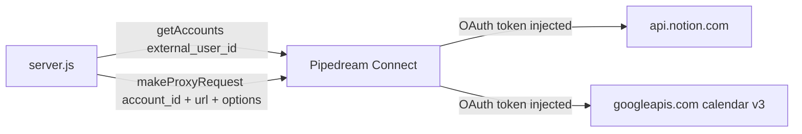

## Research Question

Derived from `task.md`:

1. How does the current Notion → Google Calendar sync run (trigger, query, mapping, create)?
2. How is sync state stored and used for dedupe?
3. How are Notion and Google Calendar reached (Pipedream proxy, accounts, auth)?
4. How is configuration loaded today (env, hardcoded values)?
5. What HTTP surface and UI exist?
6. How is the app tested and documented today?
7. Which facts about the external APIs are unverified (task risks)?

## Research Methodology (verbatim)

This document will remain objective and factual. It does not contain any recommendations or implementation suggestions.
Open questions will not ask Why things haven't been built or what should be built in the future.

There is no "implementation" section - that is intentional.

## Summary

`tools/pipedream/notion-to-google-calendar` is a single-file Express app (`server.js`, 267 lines, ESM) plus one static page. It authenticates to Notion and Google Calendar through Pipedream Connect and calls both vendor REST APIs only via `pd.makeProxyRequest`. One function, `syncTasks`, queries a Notion database once (page size 100, no filter, no cursor), and for each page with a title and date not yet recorded in `synced-tasks.json` it POSTs one event to the `primary` calendar.

State is a flat list of already-synced Notion page IDs plus `lastSyncAt`. Nothing about the created event (ID, title, date) is stored, so the app has no handle to update or delete an event, and no record of what each side looked like at sync time. The code makes no PATCH, PUT or DELETE call to either API, reads no status or tag property, and sets no reminders.

Configuration is a mix of hardcoded constants (`USER_ID`, poll interval, 09:00 UTC default, 1h duration, `primary`) and three env vars for Notion. The app has no tests. The only documentation of intended behavior is `README.md`, `AGENTS.md`, and `.env.example`, all of which state 60s polling and the `Due date` default property name.

## Detailed Findings

### 1. Sync is a single create-only pass that runs from a 60s timer or a POST

`syncTasks` (`server.js:142-171`) is the whole sync. It throws if `NOTION_DATABASE_ID` is unset, calls `queryNotionDatabase`, then loops pages:

```text
syncTasks
  queryNotionDatabase()                 # one POST /databases/:id/query
  for page in results
    extractTaskFromPage(page)           # -> { pageId, title, date }
    skip if !title || !date
    skip if pageId in syncState.syncedPageIds
    createCalendarEvent(title, date)    # POST primary/events
    push pageId to syncedPageIds
  syncState.lastSyncAt = now
  saveSyncedTasks(syncState)            # once, at end of pass
```

Per-page failures are caught and returned in `errors` (`server.js:158-164`); state is saved once after the loop (`server.js:167-168`), not after each event. The pass is triggered two ways: `POST /api/sync` (`server.js:208-216`) and a `setInterval` of `POLL_INTERVAL_MS = 60_000` registered at module load only when `NOTION_DATABASE_ID` is set (`server.js:249-262`). There is no guard against the timer and a manual call overlapping.

#### Testing patterns

No automated tests exist. `AGENTS.md` ("Testing") says to run the server and call endpoints with `curl`.

### 2. Notion is queried unfiltered with no pagination, and only title and date are read

`queryNotionDatabase` (`server.js:53-78`) POSTs `https://api.notion.com/v1/databases/{id}/query` with `Notion-Version: 2022-06-28` and body `{ page_size: 100 }`. There is no `filter`, `sorts`, or `start_cursor`; `has_more`/`next_cursor` in the response are not read. The raw proxy response is returned and `syncTasks` uses only `results`.

`extractTaskFromPage` (`server.js:80-98`) reads `props[NOTION_TITLE_PROP].title[].plain_text` joined, and `props[NOTION_DATE_PROP].date.start`. It does not read `date.end`, `date.time_zone`, `last_edited_time`, status, or tags. `NOTION_TITLE_PROP` defaults to `Name` and `NOTION_DATE_PROP` to `Due date` (`server.js:23-24`).

| Item | Value in code | Value in `task.md` context |
|------|---------------|----------------------------|
| Title property | `Name` (env `NOTION_TITLE_PROPERTY`) | `Name` |
| Date property | `Due date` (env `NOTION_DATE_PROPERTY`) | `Due` |
| Status property | not read | `Status` |
| Tags property | not read | `Tags` |

#### Testing patterns

None.

### 3. Calendar events are created on `primary` as timed 1-hour events

`createCalendarEvent` (`server.js:102-138`) resolves the user's Google Calendar account, then builds the body:

```text
startTime = new Date(dateStr)
if dateStr.length <= 10: startTime.setUTCHours(9,0,0,0)     # date-only -> 09:00 UTC
endTime   = startTime + 1h
body = { summary: title,
         start: { dateTime, timeZone: 'UTC' },
         end:   { dateTime, timeZone: 'UTC' },
         description: `Synced from Notion task: ${title}` }
POST https://www.googleapis.com/calendar/v3/calendars/primary/events
```

The body has no `extendedProperties`, `reminders`, or `date` (all-day) fields. The `description` string is the only marker linking an event to this app; it contains the title, not the page ID. The same function is reused by the manual route `POST /api/notion-to-google-calendar` (`server.js:232-245`).

#### Testing patterns

None.

### 4. Both vendors are reached through the Pipedream proxy using one account lookup helper



`pd` is created with `createBackendClient` from `@pipedream/sdk` using env credentials, project, and environment (`server.js:11-18`). `getAccountBySlug` (`server.js:45-49`) lists accounts for `USER_ID = 'demo-user-1'` (`server.js:20`) on every call and finds one by `app.name_slug` (`notion`, `google_calendar`); there is no caching. Both vendors use the same call shape: `makeProxyRequest({ searchParams: { external_user_id, account_id } }, { url, options: { method, headers, body } })` with `body` as a JSON string (`server.js:57-75`, `120-135`). Only `POST` is used anywhere. `AGENTS.md` documents that the installed SDK is v1.8.x with flat, snake_case methods and says to check `node_modules/@pipedream/sdk/dist/server.d.ts` before changing SDK calls. `package.json` declares `@pipedream/sdk ^1.4.0`.

The free plan only has the `development` environment (`AGENTS.md`).

#### Testing patterns

None.

### 5. State is a flat page-ID list written to `synced-tasks.json`

`loadSyncedTasks`/`saveSyncedTasks` (`server.js:28-41`) read and write `path.resolve('synced-tasks.json')` (relative to the process working directory). Shape:

```text
{ lastSyncAt: string|null, syncedPageIds: string[] }
```

A read or parse failure silently yields an empty state (`server.js:32-34`), which would make the next pass re-create every event. The file is written with plain `writeFileSync` (no temp file or rename). `syncState` is a module-level variable loaded once at startup (`server.js:41`). `.gitignore` lists only `node_modules` and `.env`, not `synced-tasks.json`. `GET /api/sync-status` returns `lastSyncAt`, `syncedPageIds.length`, and the database ID (`server.js:221-227`).

#### Testing patterns

None.

### 6. Configuration is env-only plus hardcoded constants

| Setting | Source | Location |
|---------|--------|----------|
| Pipedream client ID/secret, project, environment | env | `server.js:11-18` |
| `NOTION_DATABASE_ID` | env | `server.js:22` |
| Title / date property names | env with defaults | `server.js:23-24` |
| User ID | hardcoded `demo-user-1` | `server.js:20` |
| Poll interval | hardcoded 60 000 ms | `server.js:249` |
| Calendar | hardcoded `primary` | `server.js:128` |
| Time zone, default hour, duration | hardcoded UTC, 09:00, 1h | `server.js:107-111,115-116` |
| Port | env `PORT`, default 3000 | `server.js:264` |

`dotenv/config` is imported at the top (`server.js:1`). No config file or startup validation exists beyond the runtime `NOTION_DATABASE_ID` check in `syncTasks`. `.env.example` lists the Pipedream vars, `NOTION_DATABASE_ID`, `NOTION_TITLE_PROPERTY=Name`, and `NOTION_DATE_PROPERTY=Due date`.

#### Testing patterns

None.

### 7. HTTP surface is eight routes; the UI calls five of them

| Route | Method | Handler | Used by UI |
|-------|--------|---------|------------|
| `/` and static files | GET | `express.static('public')` (`server.js:9`) | n/a |
| `/api/token?app=` | GET | Connect token + link (`server.js:178-190`) | yes (`index.html:69`) |
| `/api/accounts` | GET | lists accounts (`server.js:195-203`) | yes (`index.html:82`) |
| `/api/sync` | POST | runs `syncTasks` (`server.js:208-216`) | yes (`index.html:120`) |
| `/api/sync-status` | GET | state summary (`server.js:221-227`) | yes (`index.html:92`) |
| `/api/notion-to-google-calendar` | POST | one-off event (`server.js:232-245`) | yes (`index.html:148`) |

`public/index.html` (179 lines) is a single static page with inline script; it displays `syncedCount` and `lastSyncAt` from `/api/sync-status` and the `synced`/`errors` fields of the `/api/sync` response. No routes exist for reminders, legacy cleanup, or per-pass detail.

#### Testing patterns

None; UI is verified manually.

### 8. Docs describe the current one-way behavior and are the places the task names for updating

- `README.md`: "Polls ... every 60 seconds", `Due date` default, `synced-tasks.json` semantics, 09:00 UTC, 1-hour events, endpoint table.
- `AGENTS.md`: layout table, env notes, SDK quirks, "Behavior to preserve" (60s polling note, dedupe via `synced-tasks.json`, 09:00 UTC / 1h), and the curl-based testing note.
- `.env.example`: variable list above.

The repo-level `AGENTS.md` (root) and `src/AGENTS.md` set conventions: concise writing, MermaidJS for diagrams, minimal inline comments.

#### Testing patterns

n/a.

### 9. Several external-API facts the task depends on are not verified by anything in the repo

Nothing in the repo exercises these; they are recorded as items to verify, not answered here.

| # | Item | Why it matters (from `task.md` Risks) | Status |
|---|------|----------------------------------------|--------|
| V1 | Pipedream development-environment proxy accepts `PATCH` and `DELETE` to `googleapis.com/calendar/v3` | Only `POST` is used today | Unverified |
| V2 | Same for `PATCH` to `api.notion.com/v1/pages/:id` | Only `POST` is used today | Unverified |
| V3 | `GET` through the proxy with query strings (events.list, calendarList) | Only `POST` used today | Unverified |
| V4 | Connected Google account's OAuth scopes allow `calendars.insert` and `calendarList.list` | Dedicated calendar must be auto-created | Unverified |
| V5 | Notion `Status` property type (`status` vs `select`) in "Todos" | Filter and update payload shapes differ per type | Unverified |
| V6 | Notion `Status` has option values `Pending`, `In progress`, `On-hold`, `Archived/Dropped` exactly as named | Config values and write-back depend on them | Unverified |
| V7 | Notion `Due` property exists with that name (code default is `Due date`) | Filter and read use the name | Unverified |
| V8 | All-day end date is exclusive in Google (`end.date` = last day + 1); mapping of Notion `date.end` ranges | Wrong mapping shifts or truncates ranges | Unverified |
| V9 | All-day `reminders.overrides[].minutes` count from 00:00 of event day (e.g. 540 = 09:00 the day before) | Preset values depend on it | Unverified |
| V10 | Google max 5 `reminders.overrides` per event; `popup` method accepted on a secondary calendar | Validation limit in config | Unverified |
| V11 | `events.list` with `showDeleted=true` returns `status: cancelled` for user-deleted events and honors `privateExtraProperty` and `updatedMin` filters | Calendar → Notion change and delete detection | Unverified |
| V12 | Precision and clock source of Notion `last_edited_time` (minute) vs Google `updated` (ms) | "Latest edit wins" comparison | Unverified |
| V13 | Whether the Notion proxy response for `database.query` carries `has_more`/`next_cursor` unchanged | Pagination | Unverified |
| V14 | Whether a Google event deleted by the app returns 410 on a later `GET`/`PATCH` | Distinguishing app deletes from user deletes | Unverified |

#### Testing patterns

No harness exists to run these checks; `package.json` has only a `dev` script and no test dependency.

## Code References

### Backend (exhaustive for this tool)
- `tools/pipedream/notion-to-google-calendar/server.js:11-24` — Pipedream client and env config
- `tools/pipedream/notion-to-google-calendar/server.js:28-41` — state load/save
- `tools/pipedream/notion-to-google-calendar/server.js:45-49` — account lookup by slug
- `tools/pipedream/notion-to-google-calendar/server.js:53-98` — Notion query and field extraction
- `tools/pipedream/notion-to-google-calendar/server.js:102-138` — Calendar event creation
- `tools/pipedream/notion-to-google-calendar/server.js:142-171` — `syncTasks`
- `tools/pipedream/notion-to-google-calendar/server.js:178-245` — routes
- `tools/pipedream/notion-to-google-calendar/server.js:249-267` — poll timer and listen

### Frontend and config
- `tools/pipedream/notion-to-google-calendar/public/index.html` — only static page
- `tools/pipedream/notion-to-google-calendar/.env.example` — env template
- `tools/pipedream/notion-to-google-calendar/package.json` — deps: `@pipedream/sdk`, `dotenv`, `express`; script `dev`
- `tools/pipedream/notion-to-google-calendar/.gitignore` — `node_modules`, `.env`

### Docs
- `tools/pipedream/notion-to-google-calendar/README.md`
- `tools/pipedream/notion-to-google-calendar/AGENTS.md`

### Spec tooling
- `openspec/schemas/trdspi/` — artifact schema and templates
- `openspec/config.yaml` — context rules

## Architecture Documentation

The app is a thin procedural script: module-level singletons (`app`, `pd`, `syncState`), small helper functions per vendor, one sync function, route handlers, and a timer, all in `server.js`. Vendor access is uniformly `pd.makeProxyRequest` with per-call account resolution. Persistence is a single JSON file loaded once into a module variable. There is no module split, no schema validation, no logging beyond `console`, and no concurrency control.

## Open Questions

Each item in the V1-V14 table above is an open verification question. No other open questions.
