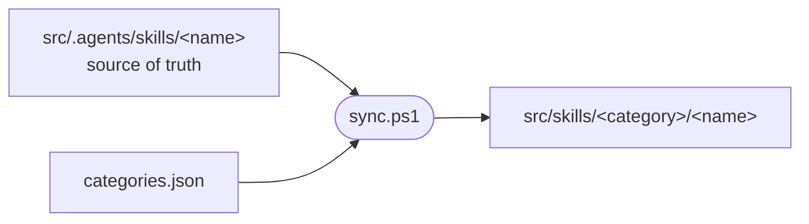

# linkSkills

Rebuilds the generated by-category skill junctions from the single source of truth, `src/.agents/skills`.

## Why

Skills are edited in one place only: `src/.agents/skills/<name>`. opencode reads them grouped by category (each config lists `src/skills/<category>` in `skills`), and the grouped view is easier for humans to browse. The script generates it as directory junctions. Nothing is copied, so edits to a skill show up everywhere at once.



## Usage

```powershell
pwsh tools/linkSkills/sync.ps1
```

Run it:
- after a fresh clone (`src/skills` is gitignored and starts empty)
- after adding, removing or renaming a skill in `src/.agents/skills`
- after editing `categories.json`

## What it does

1. Reads every entry in `src/.agents/skills`.
   - A folder is used as is.
   - A plain file is a pointer: a git symlink checked out with `core.symlinks=false`. Its content is the target directory. If the target doesn't exist, the entry is skipped with a warning.
2. Deletes the existing links under `src/skills/<category>/`, then creates one junction per skill. Real files and folders are never deleted, only reported. Empty category folders are removed.

## categories.json

```json
{
  "default": "general",
  "prefixes": {},
  "categories": { "frontend": ["angular-developer"] }
}
```

A skill's category is the first match of:
1. an explicit name in `categories`
2. the longest matching prefix in `prefixes`
3. `default`

Categories only affect the folder under `src/skills/`. They don't change the skill name.

## Notes

- **Only junctions are rebuilt.** Never put real content in `src/skills/*`. Edit `src/.agents/skills` instead.
- **Gitignored output.** Git can't track junctions on Windows, so `src/skills/*` is in `.gitignore`.
- **Windows only.** Needs PowerShell 7 (`pwsh`). Junctions don't need admin rights.
- **opencode.** `src/.opencode/opencode.jsonc` lists `src/skills/general` and `src/skills/frontend`; renaming a category means updating those paths.
