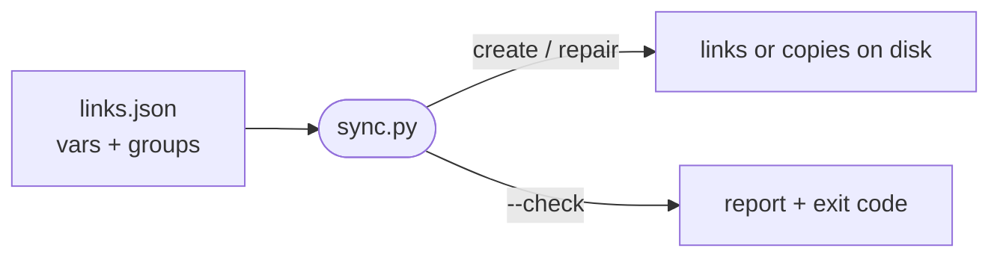

# syncLinks

Creates, repairs and audits every link (or copy) from this repo to its consumers, driven by `links.json` (repo root).

## Why

`src/` is the canonical AI config, and consumers read it through links. Doing that by hand with `mklink` drifts and breaks silently. `links.json` is the single map; this script makes the filesystem match it.



## Configuring `links.json`

`links.json` is not tracked in git. Copy the example and customize it for your machine. `links.json` may contain `//` and `/* */` comments, and `links.example.jsonc` documents every field inline:

```bash
cp links.example.jsonc links.json
```

### Variables

The `vars` object defines reusable path fragments. `${var}` expands in both `link` and `target` values.

| Variable | Description |
|---|---|
| `${self}` | The directory containing `links.json` (the repo root) |
| `${home}` | Your home directory (`~` on Unix, `%USERPROFILE%` on Windows) |

You can add your own variables and nest them:

```json
{
  "vars": {
    "repo": "${self}",
    "src": "${repo}/src",
    "nvim": "${home}/.config/nvim"
  }
}
```

### Entries

Each entry under `groups.<name>.links` describes one link or copy:

```json
{
  "link": "${home}/.config/opencode/skills",
  "target": "${repo}/src/skills",
  "method": "link",
  "scope": "folder",
  "linkType": "symlink"
}
```

| Field | Required | Values | Default | Applies to |
|---|---|---|---|---|
| `link` | Yes | path | | all |
| `target` | Yes | path | | all |
| `method` | No | `link`, `copy` | `link` | all |
| `scope` | No | `folder`, `items` | `folder` | all |
| `linkType` | No | `symlink`, `junction` | `symlink` | `method: "link"` only |
| `include` | No | glob list | `["*"]` | `scope: "items"` only |
| `exclude` | No | glob list | `[]` | `scope: "items"` only |

`method` and `scope` are independent:

| `method` | `scope` | Result |
|---|---|---|
| `link` | `folder` | `link` is one symlink or junction to `target` |
| `link` | `items` | `link` stays a real folder; each matching child of `target` is linked into it |
| `copy` | `folder` | `link` becomes a real copy of `target` |
| `copy` | `items` | `link` stays a real folder; each matching child of `target` is copied into it |

- **`method`** is what is made at `link`: a link, or a real copy.
- **`scope`** is the unit: `link` itself, or each child of `target` matching `include` and not `exclude`.
- **`linkType`** is how a link is physically made: `symlink`, or a Windows `junction` (directories only, no admin needed; falls back to symlink on macOS and Linux). It does nothing for `copy`.
- With `scope: "items"`, list `include` names explicitly. The default `["*"]` takes everything in `target`.

### Copy

Use `copy` where a link would break, for example a repo that other people clone. The copy is one-way: the source in this repo is truth, and re-running overwrites differing files and removes files that only exist in the copy. `.DS_Store` is ignored. Edit the source, not the copy.

```json
{
  "link": "${home}/Obsidian/some-template/.agents/skills",
  "target": "${src}/.agents/skills",
  "method": "copy",
  "scope": "items",
  "include": ["defuddle", "json-canvas"],
  "exclude": [".DS_Store"]
}
```

### Legacy keys

`type` (now `linkType`) and `mode` (`link` becomes `method: "link"` with `scope: "folder"`; `perFile` becomes `scope: "items"`) are still read, with a deprecation warning.

### Example: full `links.json`

```json
{
  "vars": {
    "repo": "${self}",
    "src": "${repo}/src",
    "home": "${home}"
  },
  "groups": {
    "opencode": {
      "links": [
        { "link": "${home}/.config/opencode/skills", "target": "${src}/skills", "linkType": "symlink" }
      ]
    }
  }
}
```

## Usage

```bash
python tools/syncLinks/sync.py              # create missing / fix wrong links, refresh copies
python tools/syncLinks/sync.py --check      # audit only (links and copy drift), exit 1 if anything is off
python tools/syncLinks/sync.py --group <name>   # one or more groups (names from links.json)
python tools/syncLinks/sync.py --dry-run    # preview without changing anything
python tools/syncLinks/sync.py --config <path>  # use another links file
```

On Windows, symlinks need an **elevated shell or Windows Developer Mode**. Junctions (directories only) do not.

## What it does per link (`method: "link"`)

| State on disk | Action |
|---|---|
| link missing | create it (parent folders too) |
| link with the wrong target | remove the link only, recreate it |
| empty real folder in the way | remove the empty folder, create the link |
| non-empty real folder or file in the way | warning, left alone (counts as not ok) |
| target missing | warning, skipped (counts as not ok) |
| correct link | nothing |

It never recurses into a link and never deletes link targets. Links that exist but are not declared in `links.json` are ignored.

## What it does per copy (`method: "copy"`)

| State on disk | Action |
|---|---|
| destination missing | copy it |
| destination identical (same files and SHA-256) | nothing |
| files differ, missing or extra | report `drift`, then overwrite changed files and remove extras |
| symlink or junction in the way | warning, left alone (counts as not ok) |
| target missing | warning, skipped (counts as not ok) |

It only touches files inside the destination. `--check` and `--dry-run` change nothing.

Add, move or remove a link or copy by editing `links.json`, then re-run the script.

## Cross-platform notes

- **macOS / Linux**: Uses symbolic links for everything.
- **Windows**: Uses directory junctions when `linkType: "junction"` is specified (no admin needed). File symlinks and directory symlinks with `linkType: "symlink"` require admin or Developer Mode.

## Out of scope

- Skill junctions inside `src` (`src/skills/<category>/`) belong to `tools/linkSkills/sync.py`.
