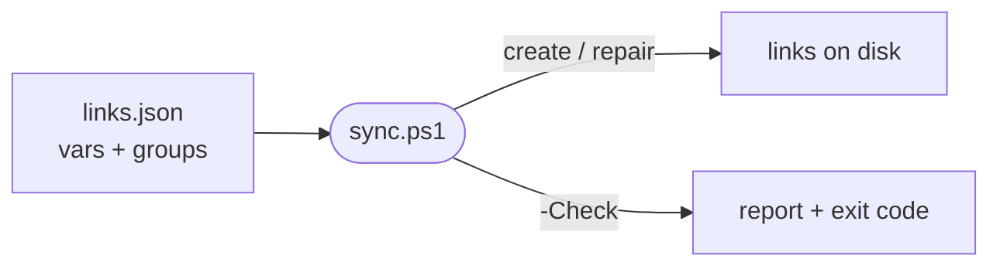

# syncLinks

Creates, repairs and audits every link from this repo to its consumers, driven by `links.json` (repo root).

## Why

`src/` is the canonical AI config, and consumers read it through links. Doing that by hand with `mklink` drifts and breaks silently. `links.json` is the single map; this script makes the filesystem match it.



## Usage

```
pwsh tools/syncLinks/sync.ps1                 # create missing / fix wrong links
pwsh tools/syncLinks/sync.ps1 -Check          # audit only, exit 1 if anything is off
pwsh tools/syncLinks/sync.ps1 -Group <name>   # one or more groups (names from links.json)
pwsh tools/syncLinks/sync.ps1 -WhatIf         # preview without changing anything
pwsh tools/syncLinks/sync.ps1 -Config <path>  # use another links file
```

Symlinks need an **elevated shell or Windows Developer Mode**. Junctions (directories only) do not.

## What it does per link

| State on disk | Action |
|---|---|
| link missing | create it (parent folders too) |
| link with the wrong target | remove the link only, recreate it |
| empty real folder in the way | remove the empty folder, create the link |
| non-empty real folder or file in the way | warning, left alone (counts as not ok) |
| target missing | warning, skipped (counts as not ok) |
| correct link | nothing |

It never recurses into a link and never deletes link targets. Links that exist but are not declared in `links.json` are ignored.

## links.json

```json
{
  "vars":   { "src": "C:\\dev\\Git\\ai-tools\\src" },
  "groups": {
    "example": {
      "links": [
        { "link": "C:\\some\\consumer\\skills", "target": "${src}\\skills", "type": "symlink" }
      ]
    }
  }
}
```

- `${var}` expands from `vars` (nested allowed).
- `type`: `symlink` or `junction`. A junction entry whose target is a file falls back to a symlink.
- `mode: "perFile"` links each item of `target` that matches `include` (and not `exclude`) into the `link` folder, so the folder stays a real one.

Add, move or remove a link by editing `links.json`, then re-run the script.

## Out of scope

- Skill junctions inside `src` (`src/skills/<category>/`) belong to `tools/linkSkills/sync.ps1`.
