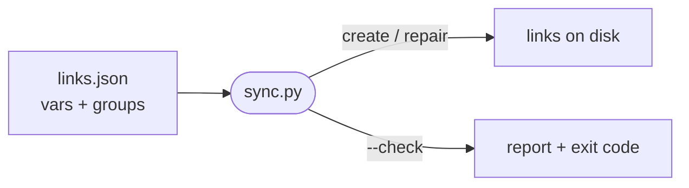

# syncLinks

Creates, repairs and audits every link from this repo to its consumers, driven by `links.json` (repo root).

## Why

`src/` is the canonical AI config, and consumers read it through links. Doing that by hand with `mklink` drifts and breaks silently. `links.json` is the single map; this script makes the filesystem match it.



## Configuring `links.json`

`links.json` is not tracked in git. Copy the example and customize it for your machine:

```bash
cp links.example.json links.json
```

### Variables

The `vars` object defines reusable path fragments. `${var}` expands in both `link` and `target` values.

| Variable | Description |
|---|---|
| `${self}` | The directory containing `links.json` (the repo root) |
| `${home}` | Your home directory (`~` on Unix, `%USERPROFILE%` on Windows) |

You can add your own variables and nest them:

```json
{
  "vars": {
    "repo": "${self}",
    "src": "${repo}/src",
    "nvim": "${home}/.config/nvim"
  }
}
```

### Link entries

Each entry under `groups.<name>.links` describes one filesystem link:

```json
{
  "link": "${home}/.config/opencode/skills",
  "target": "${repo}/src/skills",
  "type": "symlink"
}
```

| Field | Required | Description |
|---|---|---|
| `link` | Yes | The path that must exist (the alias/shortcut) |
| `target` | Yes | What `link` should point to |
| `type` | Yes | `symlink` or `junction`. On non-Windows OS, `junction` falls back to symlink. |
| `mode` | No | `link` (default) or `perFile` |

### `perFile` mode

Links each matching item inside `target` into `link` as individual links. The `link` path stays a real folder.

```json
{
  "link": "${home}/.config/opencode/skills",
  "target": "${repo}/src/skills",
  "type": "symlink",
  "mode": "perFile",
  "include": ["*"],
  "exclude": [".gitkeep"]
}
```

### Example: full `links.json`

```json
{
  "vars": {
    "repo": "${self}",
    "src": "${repo}/src",
    "home": "${home}"
  },
  "groups": {
    "opencode": {
      "links": [
        { "link": "${home}/.config/opencode/skills", "target": "${src}/skills", "type": "symlink" }
      ]
    }
  }
}
```

## Usage

```bash
python tools/syncLinks/sync.py              # create missing / fix wrong links
python tools/syncLinks/sync.py --check      # audit only, exit 1 if anything is off
python tools/syncLinks/sync.py --group <name>   # one or more groups (names from links.json)
python tools/syncLinks/sync.py --dry-run    # preview without changing anything
python tools/syncLinks/sync.py --config <path>  # use another links file
```

On Windows, symlinks need an **elevated shell or Windows Developer Mode**. Junctions (directories only) do not.

## What it does per link

| State on disk | Action |
|---|---|
| link missing | create it (parent folders too) |
| link with the wrong target | remove the link only, recreate it |
| empty real folder in the way | remove the empty folder, create the link |
| non-empty real folder or file in the way | warning, left alone (counts as not ok) |
| target missing | warning, skipped (counts as not ok) |
| correct link | nothing |

It never recurses into a link and never deletes link targets. Links that exist but are not declared in `links.json` are ignored.

Add, move or remove a link by editing `links.json`, then re-run the script.

## Cross-platform notes

- **macOS / Linux**: Uses symbolic links for everything.
- **Windows**: Uses directory junctions when `type: "junction"` is specified (no admin needed). File symlinks and directory symlinks with `type: "symlink"` require admin or Developer Mode.

## Out of scope

- Skill junctions inside `src` (`src/skills/<category>/`) belong to `tools/linkSkills/sync.py`.
